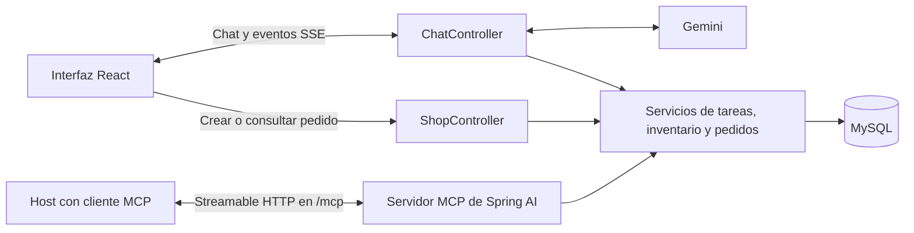
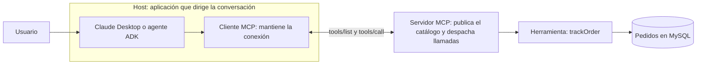

# Laboratorio 3 – Asistente de supermercado con Spring AI y MCP

**Curso:** Arquitectura de Software  
**Programa:** Ingeniería de Sistemas – Universidad de Antioquia  
**Autor:** Mateo Upegui Borja · [Correo institucional](mailto:mateo.upeguib@udea.edu.co)

## 1. Introducción

ShopMCP permite gestionar tareas, consultar el inventario de un supermercado y hacer seguimiento a pedidos a domicilio. En el chat se puede pedir «Muéstrame los productos disponibles», seleccionar cantidades en el catálogo y confirmar el pedido desde el carrito. Después, incluso en una conversación nueva del mismo navegador, se puede preguntar «¿Cómo va mi último pedido?».

## 2. Objetivos

- Exponer las operaciones del dominio como herramientas que distintas aplicaciones puedan descubrir e invocar mediante el *Model Context Protocol* (MCP).
- Integrar Gemini con los servicios de Spring y con herramientas que consultan el estado del navegador.
- Conservar en MySQL los pedidos y el estado de cada producto, de modo que el seguimiento refleje los cambios de entrega.

## 3. Herramientas y requisitos

| Componente | Uso en el laboratorio |
| --- | --- |
| JDK 21 y Maven Wrapper | Compilar y ejecutar Spring Boot 4.1.2. El repositorio incluye Maven Wrapper. |
| Spring AI 2.0.2 | Integrar Gemini, registrar herramientas y publicar el servidor MCP. |
| Docker con Compose y MySQL 8.4 | Ejecutar la base de datos local con un volumen persistente. |
| Node.js 22.12 o superior y npm | Compilar la interfaz React con TypeScript y Vite. |
| Clave de la API de Gemini | Habilitar el chat con el modelo configurado, `gemini-3.5-flash-lite`. |

## 4. Arquitectura

El backend ofrece dos vías para usar los servicios de negocio. El chat web recibe mensajes en `/api/chat/stream`, consulta a Gemini y ejecuta directamente las herramientas registradas en Spring AI. Un host externo puede descubrir e invocar herramientas a través de `/mcp`, con el transporte **Streamable HTTP**. Ambos caminos llegan a los servicios Java y sus repositorios JPA.



**Dónde vive el estado.** MySQL conserva las tareas, las existencias, los pedidos y el estado de cada artículo. React mantiene el carrito en memoria y guarda en el almacenamiento local del navegador los identificadores de los pedidos realizados. Para responder por el último pedido, el chat puede invocar `listOrderIds` en el navegador y pasar el identificador obtenido a `trackOrder` en el backend. Las herramientas del navegador viajan por el canal del chat y tienen acceso a esa sesión de la interfaz. El registro público de herramientas MCP se define por separado. [Registro MCP](src/main/java/com/udea/shopmcp/ArqLab03Application.java) · [Controlador del chat](src/main/java/com/udea/shopmcp/controllers/ChatController.java)

## 5. Configuración y ejecución

Ejecuta los comandos desde la raíz del repositorio.

### 5.1. Variables de entorno

Crea un archivo `.env` en la raíz y reemplaza los valores de ejemplo. Spring importa ese archivo al arrancar y Compose lo utiliza para inicializar MySQL. Conserva las credenciales fuera del control de versiones. [Configuración de Spring](src/main/resources/application.properties) · [Configuración de Compose](compose.yaml)

```dotenv
SHOPMCP_DB_USER=shopmcp_app
SHOPMCP_DB_PASSWORD=reemplazar_por_clave_de_la_aplicacion
MYSQL_ROOT_PASSWORD=reemplazar_por_otra_clave_de_administracion
SHOPMCP_GEMINI_API_KEY=reemplazar_por_clave_de_gemini
```

| Variable | Quién la usa | Función |
| --- | --- | --- |
| `SHOPMCP_DB_USER` | MySQL y Spring | Usuario de aplicación que accede a la base `shopmcp`. |
| `SHOPMCP_DB_PASSWORD` | MySQL y Spring | Contraseña de ese usuario. |
| `MYSQL_ROOT_PASSWORD` | Contenedor MySQL | Contraseña de administración al inicializar el volumen. |
| `SHOPMCP_GEMINI_API_KEY` | Backend Spring | Credencial para las llamadas a Gemini. |

### 5.2. Arrancar la aplicación

```bash
docker compose up -d --wait mysql
npm --prefix ui ci
npm --prefix ui run build
./mvnw spring-boot:run
```

Abre [la aplicación local](http://localhost:8080/). Compose publica MySQL en `127.0.0.1:3306`. Al arrancar, Spring actualiza el esquema y ejecuta la carga inicial del inventario. Maven incorpora `ui/dist` como contenido estático, por lo que el orden de compilación anterior permite servir el chat y la API en el mismo puerto.

Para editar la interfaz con recarga automática, deja Spring en ejecución y abre otra terminal con `npm --prefix ui run dev`. Abre la URL que imprima Vite. Su proxy reenvía las solicitudes de `/api` al puerto 8080. El almacenamiento del navegador es independiente para cada origen, incluido el puerto.

### 5.3. Comprobar el funcionamiento

1. Pide «Muéstrame los productos disponibles», agrega un artículo y confirma el pedido con una dirección.
2. Inicia otra conversación en el mismo navegador y origen. Pregunta «¿Cómo va mi último pedido?» y compara el código de seguimiento con el del comprobante.
3. Para comprobar el servidor MCP por separado, configura un cliente que admita Streamable HTTP con la URL `http://localhost:8080/mcp`. Al listar las herramientas deben aparecer, entre otras, `listAvailableProducts` y `trackOrder`.

Con MySQL en ejecución, usa `./mvnw test` para las pruebas del backend y `node --test src/test/js/*.test.mjs` para las pruebas JavaScript.

## 6. Preguntas del laboratorio

### 6.1. ¿Qué diferencia hay entre host, cliente MCP, servidor MCP y herramienta?



Ante «¿Dónde está mi pedido?», el **host** aporta la conversación, el modelo y las políticas de ejecución. Su **cliente MCP** descubre las herramientas mediante `tools/list` y envía una invocación con `tools/call`. El **servidor MCP** anuncia el nombre, la descripción y el esquema de entrada de cada herramienta y dirige la petición al método correspondiente. La **herramienta** realiza la operación concreta. En este caso, `trackOrder` recibe un UUID y devuelve los artículos del pedido con sus estados. El resultado vuelve por el cliente al host, que lo presenta al usuario. [Arquitectura de MCP](https://modelcontextprotocol.io/docs/learn/architecture)

### 6.2. ¿Qué cambia entre Claude Desktop y Google ADK? ¿Qué código se reutiliza?

| Aspecto | Claude Desktop | Agente construido con Google ADK |
| --- | --- | --- |
| Host | Aplicación de escritorio con conversación e interfaz incluidas. | Aplicación programable en la que el desarrollador define el agente, sus instrucciones y sus herramientas. |
| Conexión | Se configura un conector compatible con el transporte del servidor. Para una conexión local basada en procesos, hace falta un puente de stdio a HTTP, porque ShopMCP escucha en HTTP. | Se configura un conjunto de herramientas MCP con la URL del servidor y el transporte Streamable HTTP. |
| Presentación | Claude incorpora el resultado a su conversación. | La aplicación decide cómo presentar el resultado o usarlo en otro paso del agente. |

**Se reutiliza todo el camino desde `/mcp` hasta MySQL**: el registro de herramientas, sus nombres y esquemas, los servicios Java, las validaciones y los repositorios. Si ambos hosts consultan el mismo UUID con `trackOrder`, se ejecuta el mismo método sobre el mismo pedido. Cada host aporta su conexión y su interfaz. El carrito de React y sus identificadores locales pertenecen al navegador que los creó. Esta comparación describe dos integraciones posibles del servidor. [Claude Desktop y servidores locales](https://modelcontextprotocol.io/docs/develop/connect-local-servers) · [Herramientas MCP en Google ADK](https://adk.dev/tools-custom/mcp-tools/)

### 6.3. ¿Qué riesgo tiene exponer herramientas HTTP sin autenticación y cómo se mitiga?

Si se publica `/mcp` sin control de acceso, una persona con acceso de red podría invocar `restockProduct` y alterar las existencias. El catálogo mostraría unidades que el supermercado quizá no tenga. La contraseña de MySQL protege la conexión a la base, pero el servidor ya dispone de esa credencial para ejecutar la operación.

**Mitigación propuesta.** Proteger el endpoint con HTTPS y autenticación mediante tokens de acceso. Antes de despachar cada llamada, el servidor debe validar el token y exigir un permiso acorde con la operación. Por ejemplo, una identidad con permiso de lectura puede consultar productos y solo el personal autorizado puede reponer inventario. Si otra ruta incorpora la reposición de inventario, debe exigir el mismo permiso. [Autorización en MCP](https://modelcontextprotocol.io/specification/latest/basic/authorization)

## 7. Conclusiones

El contrato MCP permite cambiar de host sin duplicar las reglas del supermercado. La ubicación del estado determina qué herramienta conviene invocar: el navegador sabe qué pedidos se hicieron desde ese origen y el servidor conoce el estado actual de sus artículos. Combinar ambas consultas permite seguir un pedido después de cerrar el chat sin copiar su estado de entrega al navegador.
